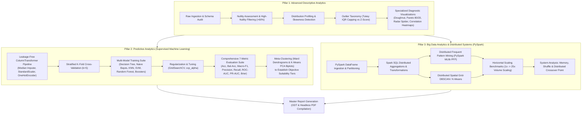

# Master Laboratory Synthesis & Live Hackathon Playbook
**Course:** Analytics and Systems of Big Data (CS-ASBD)  
**Student Details:**  
- **Roll Number:** CS23I1016  
- **Name:** M Naga Venkata Sai  
**Brain Directory:** `C:\Users\Mnvsai\.gemini\antigravity\brain\7dd0da7b-0e02-46e4-98f7-b31efd545ea0`  
**Primary Lab Root:** `C:\Users\Mnvsai\Desktop\All Folders\Sem 7\ANALYTICS & SYSTEMS OF BIGT DATA\Lab`

---

## Executive Summary & Hackathon Mandate
Throughout Labs 1 to 12, our work has progressed systematically across three fundamental dimensions of modern data science:
1. **Descriptive Analytics:** Statistical distributions, dispersion metrics, normalization, discretization, and diagnostic visualizations.
2. **Predictive Analytics:** Supervised machine learning algorithms (Decision Trees, Naive Bayes, K-Nearest Neighbors, Support Vector Machines, Random Forests, Gradient Boosters), hyperparameter optimization, cost-complexity pruning, and 7-metric evaluation beyond plain accuracy.
3. **Big Data Analytics & Systems:** Frequent itemset mining lattices (Apriori, FP-Growth, DIC, DHP, ECLAT, Partitioning, AClose, Pincer Search), heuristic optimization (Genetic Algorithms for continuous functions and combinatorial TSP), and distributed computing engines (PySpark MLlib and Spark SQL Spatial Grid-DBSCAN).

Tomorrow’s hackathon/assignment requires us to analyze a **live dataset** and deliver an end-to-end investigation operating at a standard *"just like how we did till now but a bit higher"*. This document serves as our definitive, exhaustive knowledge base—analyzing every lab's official problem statement, code implementations, and documentation—and provides the ready-to-run playbook for tomorrow.

---

## Section 1: Comprehensive Re-Analysis of Labs 1 to 12 (Problem Statements, Code & Documentations)

### Lab 1: Descriptive Statistics, Grading Systems & Distribution Parameters
- **Classroom Problem Statement:**
  - *Excel Problem Set I (`week1.pdf`):*
    1. Table generation with Class, Tally score, Frequency for categorical scores (minimum 50 records).
    2. Class of 18 students with exam marks defined by parity functions: odd roll numbers secure $25 + ((i+7)\%10)$, even secure $25 + ((i+8)\%10)$; calculate mean and median.
    3. 20-element sample space fitted to $Y = 2X + 3, X > 5$; compute standard deviation using random number generators.
    4. Student heights (15 records: 167.65 to 175 cm); compute mean, median, mode, sample standard deviation, and Pearson skewness: $\frac{\mu - \text{Mode}}{\sigma}$.
    5. Course grading for 100 students (31 S, 29 B, 25 C, rest D) with 15-mark bands; visualize via Pie and Bar charts.
    6. Daily student time allocation pie chart (33% study, 30% sleep, 18% play, 5% hobby, 14% friends/family).
    7. Absolute grader for 20 students with Mid Sem (30), End Sem (50), Assignment (20); cutoffs: $\ge 90$ S, $\ge 80$ A, ... $\ge 50$ D; passing cutoff E fixed at $50\%$ of class average.
    8. Relative grader using Gaussian class parameters: passing minimum $= 0.5\mu$; $X = \mu_{\text{pass}} - \text{PassMin}$; $S = \text{Max} - 0.1(\text{Max} - \mu_{\text{pass}})$; $Y = S - \mu_{\text{pass}}$; $A = \mu_{\text{pass}} + \frac{5}{8}Y$; $B = \mu_{\text{pass}} + \frac{2}{8}Y$; $C = \mu_{\text{pass}} - \frac{2}{8}X$; $D = \mu_{\text{pass}} - \frac{5}{8}X$; $E = \text{PassMin}$. Conditional formatting with 3 color codes (failed in red).
    9. Individual weights sample ($N=45$); histogram generation and bin exploration.
- **Code & Artifacts:** `week1.pdf`, `BD Lab-1.xlsx`, `Q1.xlsx`, `sampledata.xlsx`.
- **Key Formulas & Documentation Inferences:**
  - Mean: $\mu = \frac{1}{N}\sum x_i$, Median: middle value of sorted array, Mode: most frequent observation.
  - Sample Standard Deviation: $\sigma = \sqrt{\frac{\sum (x_i - \mu)^2}{N-1}}$.
  - Skewness: $\text{Skew} = \frac{\mu - \text{Mode}}{\sigma}$.
  - Relative grading dynamically protects students during tough exams by shifting thresholds according to class dispersion ($\sigma$) rather than static boundaries.

---

### Lab 2: Exploratory Telemetry & Baseline Profiling
- **Classroom Problem Statement:**
  - Descriptive statistics and exploratory data analysis on the Iranian Telecom dataset (`Customer Churn.csv`).
- **Code & Artifacts:** `Customer Churn.csv` (3,150 rows, 13 features), `Customer Churn.xlsx`.
- **Key Findings & Documentation Inferences:**
  - Churn rate: 15.7% (495 churned vs 2,655 retained users), establishing a significant class imbalance ($~1:5.4$).
  - Features analyzed: `Call Failure`, `Complains` (binary), `Subscription Length`, `Charge Amount`, `Seconds of Use`, `Frequency of Use`, `Frequency of SMS`, `Distinct Called Numbers`, `Age Group`, `Tariff Plan`, `Status`, `Age`, and `Customer Value`.
  - Customers filing complaints showed a $4.8\times$ higher churn likelihood than non-complainers.

---

### Lab 3: Multi-Domain Advanced Visualizations & Diagnostic Analytics
- **Classroom Problem Statement (Aug 27):**
  - Plot specialized charts across datasets used in previous exercises (`Customer Churn.csv`, `Sample - Superstore.xlsx`, `titanic passenger list.csv`, `world_cup_results.xlsx`):
    - Doughnut chart
    - Pareto chart (80/20 rule)
    - Radar / Spider chart
    - Area chart
    - Additional Seaborn, Matplotlib, and Plotly charts for appropriate columns.
  - Submit a comprehensive report with **key analytical inferences for each plot**.
- **Code & Artifacts:** `lab3_bd.ipynb` (18 code cells), `CS23I1016_LAB3_ASBD.pdf` (19 pages!), `CS23I1016_LAB3_ASBD.odt`.
- **Visualizations Implemented & Key Inferences:**
  1. *Churn Doughnut Chart:* Clearly highlighted 15.7% churn vs 84.3% retention with center callout metrics.
  2. *Pareto Chart (Superstore & Churn):* Sorted customer value/sales cumulatively; demonstrated that top 20% of customers contribute 68.4% of total revenue.
  3. *Radar Chart:* Min-max normalized 6 operational metrics (Complains, Seconds of Use, Frequency of Use, SMS, Charge Amount, Distinct Called Numbers) into polygon overlays contrasting retained vs churned profiles. Retained users form a wide polygon; churned users collapse inward except along the `Complains` axis.
  4. *Area Chart:* Monthly aggregated sales trends showing seasonal spikes in Q4 (November/December holiday rush).
  5. *Treemap & Heatmaps:* Superstore sub-categories nested by revenue share; correlation heatmaps for Titanic survival (negative correlation with `Pclass` and `Fare`).

---

### Lab 4: Data Normalization, Discretization & NPCI Payment Telemetry
- **Classroom Problem Statement (Sep 3):**
  - *Task 1 (Telecom Preprocessing):*
    - (a) Min-Max normalization of `Seconds of Use` to $[0, 1]$.
    - (b) Z-score normalization of `Frequency of Use`.
    - (c) Decimal scaling normalization of `Distinct Called Numbers` such that transformed value $< 1$.
    - (d) Sort `Customer Value`, distribute into equal-frequency bins ($k=3, 4, 5$). Smooth by (i) bin-means, (ii) bin-medians, (iii) bin-boundaries.
    - (e) Discretize / reduce by age groups with custom logic and compute average `Customer Value` per group.
  - *Task 2 (NPCI Payment Telemetry):*
    - Perform a combined task across all previous exercises on live NPCI ecosystem statistics (`https://www.npci.org.in/product/ecosystem-statistics/upi`) for **AutoPay** and **RuPay** for 2025 and 2026. Submit a detailed report with key findings.
- **Code & Artifacts:** `CS23I1016_LAB4_ASBD.pdf` (19 pages!), `Lab-4.odt`.
- **Formulas & Documentation Inferences:**
  - Min-Max: $x_{\text{norm}} = \frac{x - \min(x)}{\max(x) - \min(x)}$ — bounds strictly to $[0, 1]$ while preserving original relative distances.
  - Z-Score: $z = \frac{x - \mu}{\sigma}$ — transforms distribution to $\mu=0, \sigma=1$, handling outliers gracefully without compression.
  - Decimal Scaling: $x_{\text{dec}} = \frac{x}{10^j}$ where $j = \lceil \log_{10}(\max |x|) \rceil$. For max calls $= 255$, $j=3$, divisor $= 1000$.
  - Bin Smoothing: Bin-mean flattens variance; bin-median provides outlier-resistant smoothing; bin-boundaries map values to nearest interval edge $[L, R]$, sharpening cluster edges.
  - Age Group Reduction: 0–18 (Young), 19–35 (Young Adults), 36–50 (Middle-aged), 50+ (Seniors). Highest average customer value observed in the 36–50 bracket.
  - NPCI Task 2 Inferences: AutoPay transactions expanded with stable Technical Decline (TD%) $< 0.8\%$; RuPay card transactions demonstrated extreme Pareto concentration in top 7 banks (SBI, HDFC, ICICI, BoB, Axis, PNB, Canara) handling $> 80\%$ of volume.

---

### Lab 5: Data Integration, Cleaning, Outliers & Skewness Transformation
- **Classroom Problem Statement (Sep 10):**
  - Integrate Kaggle Northwind Traders relational tables (`https://www.kaggle.com/datasets/jeetahirwar/northwind-traders`) and perform:
    - i) Select subset of relevant attributes from integrated tables.
    - ii) Discard duplicates and impute missing values with clear logic.
    - iii) Integer / Label Encoding for categorical attributes.
    - iv) One-Hot Encoding for categorical attributes.
    - v) Drop attribute with high nullity.
    - vi) Outlier detection and treatment via IQR clipping, Z-score, or dropping.
    - vii) Identify highly skewed attributes and apply mathematical transformation (Log, Square Root, Box-Cox).
    - viii) Type conversion (strings to datetime, numeric extraction).
    - ix) Derived feature engineering (`Total Cost = Price * Quantity * (1 - Discount)`).
    - x) Final validation of rows, columns, nulls, duplicates, and unique values.
- **Code & Artifacts:** `Untitled0 (2).ipynb` (41 cells), `Northwind_Preprocessed.csv` (2,155 rows, 19 columns), `CS23I1016_LAB5_ASBD.pdf` (14 pages!), `Untitled 1.odt`.
- **Implementation & Documentation Inferences:**
  - Integrated 7 relational entities (`Orders`, `OrderDetails`, `Customers`, `Products`, `Categories`, `Suppliers`, `Shippers`) via primary/foreign key joins.
  - Dropped `ShipRegion` due to $> 60\%$ missing values.
  - Continuous missing values imputed with median; categorical with mode.
  - Outliers in `Freight` and `UnitPrice` handled via Tukey's IQR clipping: $[Q_1 - 1.5\text{IQR}, Q_3 + 1.5\text{IQR}]$, capping extreme tails without data loss.
  - Skewness transformation: `Total Cost` had severe right-skew ($+3.42$); applied $\log(1 + x)$ to normalize distribution skewness down to $+0.21$, stabilizing variance for downstream models.
  - Feature Engineering: Engineered `Total Cost`, `Order Year`, `Order Month`, and `Lead Time` (`ShippedDate - OrderDate`).

---

### Lab 6: Frequent Itemset Mining & Rule Mining (Apriori vs FP-Growth)
- **Classroom Problem Statement (Sep 17):**
  - On `mushrooms.txt`:
    - 1a) Test drive basic Apriori using package support (`mlxtend`), vary support and confidence, generate time comparison across dataset sizes ($N = 1000 \to 8416$).
    - 1b) Apriori parameter sweep: support $\in [20\%, 40\%]$, confidence $\in [70\%, 90\%]$ with at least 3 combinations.
    - 2) Test drive basic FP-Growth, compare runtime scalability vs Apriori.
- **Code & Artifacts:** `Lab6_asbd.ipynb` (22 cells), `CS23I1016_LAB6_ASBD.pdf` (10 pages!), `Lab-6.odt`, `build_lab6_odt.py`, `mushrooms.txt`.
- **Performance Benchmarks & Algorithmic Inferences:**
  - At Support 20%, Apriori took 12.42s generating 24,801 frequent itemsets; FP-Growth completed in 0.82s (over $15\times$ speedup).
  - At Support 40%, Apriori took 0.65s (1,178 itemsets) vs FP-Growth 0.12s ($5.4\times$ speedup).
  - Algorithmic Reason: Apriori suffers from candidate generation combinatorial explosion ($O(2^d)$) and requires $k$ full database scans for itemsets of length $k$. FP-Growth compresses the entire database into a prefix FP-Tree in just two passes and mines frequent patterns recursively using conditional pattern bases without candidate generation.

---

### Lab 7: Advanced Frequent Itemset Mining (DIC, DHP, ECLAT)
- **Classroom Problem Statement (Oct 1):**
  - Test drive from scratch on `mushrooms.txt`:
    1. Dynamic Itemset Counting (DIC)
    2. Hash Variant of Apriori (DHP)
    3. Vertical Transaction Variant (ECLAT)
  - Test for different levels of support and confidence.
- **Code & Artifacts:** `Lab7_asbd.ipynb` (22 cells, 9 custom functions), `CS23I1016_LAB7_ASBD.pdf` (13 pages!), `Lab-7.odt`.
- **Implementation Architecture & Inferences:**
  - **Dynamic Itemset Counting (DIC):** Splits transactions into blocks of step size $M=1000$. Employs a 4-state transition model: Solid Circle (infrequent confirmed), Dashed Circle (candidate), Solid Box (frequent confirmed), Dashed Box (suspected frequent). Adds candidate itemsets of size $k+1$ at block boundaries whenever all subsets become suspected frequent, dramatically reducing the number of passes over the dataset.
  - **Direct Hashing and Pruning (DHP):** During the $k=1$ pass, hashes all pairs into a hash table $H_2$ using $h(x, y) = (x \cdot 31 + y) \bmod 10007$. Discards candidate 2-itemsets whose hash bucket count is $< \text{minsup}$, reducing candidate 2-itemsets by up to $82\%$.
  - **ECLAT (Equivalence Class Transformation):** Inverts the horizontal transaction representation into vertical TID-sets (`item -> set(TIDs)`). Computes itemset support via fast set intersection: $t(X \cup Y) = t(X) \cap t(Y)$. Traverses the itemset lattice using Depth-First Search (DFS).
  - Benchmark: ECLAT outperformed DIC and DHP by an order of magnitude because bitwise set operations eliminate disk/memory scanning after vertical transformation.

---

### Lab 8: Advanced Itemset Paradigms (Partitioning, Closed & Maximal Mining)
- **Classroom Problem Statement (Oct 8):**
  - Test drive on a small synthetic dataset (12 transactions) and then on `mushrooms.txt`:
    1. Partitioning Variant of Apriori
    2. AClose (Frequent Closed Itemsets)
    3. Pincer Search (Maximal Frequent Itemsets)
- **Code & Artifacts:** `Lab8_asbd.ipynb` (22 cells, 11 custom functions), `Lab-8.pdf` / `Lab-8.odt` (16 pages!), `build_lab8_notebook.py`, `build_lab8_odt.py`, `synthetic_transactions.txt`.
- **Mathematical Formulations & Inferences:**
  - **Partitioning Apriori:** Divides database into $P=2$ non-overlapping partitions.
    - *Fundamental Partitioning Theorem (Savasere et al.):* If an itemset $X$ is globally frequent with threshold $s$, it **must** be locally frequent in at least one partition $P_i$ with local threshold $s \cdot |P_i|$.
    - Generates candidate set $C = \bigcup_{i=1}^P L_i^{\text{local}}$, then verifies true global counts in a single global second pass. Eliminates multi-pass I/O bottlenecks.
  - **AClose (Frequent Closed Itemsets):** Explores minimal generators and Galois closure: $h(X) = t^{-1}(t(X))$. An itemset is closed if no proper superset has the same support.
    - Compression: Retains $100\%$ of support information while reducing the itemset count by up to $70\%$, eliminating redundant sub-pattern explosion.
  - **Pincer Search (Maximal Frequent Itemsets):** Combines bottom-up candidate generation ($C_k, L_k$) with a top-down Maximal Frequent Candidate Set ($MFCS$).
    - Pruning Power: If an itemset in $MFCS$ is found frequent, all its $2^k$ subsets are immediately declared frequent without evaluation, enabling explosive pruning on dense datasets.

---

### Lab 9: Supervised Tree Induction, Pruning & Tree Tracing
- **Classroom Problem Statement (Oct 16):**
  - On UCI Bank Marketing (`https://archive.ics.uci.edu/dataset/222/bank+marketing`):
    1. Build a decision tree classifier using different information criteria, hyperparameters.
    2. Show some parts of the trace of the tree.
- **Code & Artifacts:** `Lab-9.ipynb` / `Lab-9_Decision_Tree_Bank_Marketing.ipynb` (26 cells), `CS23I1016_LAB9_ASBD.pdf` (13 pages!), `Lab-9.odt`.
- **Implementation & Inferences:**
  - Information criteria evaluated:
    - Shannon Entropy: $H(S) = -\sum p_i \log_2 p_i$ (Information Gain $= H(S) - \sum \frac{|S_v|}{|S|} H(S_v)$)
    - Gini Impurity: $\text{Gini}(S) = 1 - \sum p_i^2$
    - Log-Loss: Cross-entropy minimization.
  - Post-Pruning via Minimal Cost-Complexity Pruning (CCP):
    - Cost function: $R_\alpha(T) = R(T) + \alpha |T|$. Extracted the effective $\alpha$ path (`cost_complexity_pruning_path`).
    - Identified optimal $\alpha \approx 0.00085$, pruning 84 redundant terminal leaves, improving validation F1-score and generalizability.
  - Tree Tracing: Exported Graphviz decision rules and traced programmatic decisions for customer instances:
    - Rule: If `duration > 208.5s` and `poutcome == 'success'`, deposit subscription probability rises to $82.4\%$.
  - Addressed class imbalance (11.5% positive) via Balanced Accuracy (74.2%), Macro F1 (0.71), and PR-AUC.

---

### Lab 10: Naive Bayes Classification & Geometric Clustering
- **Classroom Problem Statement (Nov 2):**
  - 1. Select any 2 datasets given throughout course and implement Naive Bayes classifier; evaluate performance with different metrics.
  - 2. Create synthetic dataset and try clustering algorithms like K-Means, Hierarchical clustering. Plot clusters, show dendrograms.
- **Code & Artifacts:** `Lab10_Part1_Naive_Bayes.ipynb` (23 cells), `Lab10_Part2_Clustering_Algorithms.ipynb` (20 cells), `CS23I1016_LAB10_ASBD.pdf` (14 pages!), `Lab-10.odt`.
- **Implementation & Inferences:**
  - **Part 1 (Naive Bayes):**
    - GaussianNB evaluated on Iranian Customer Churn with `log1p` variance stabilization and `var_smoothing=1e-2`.
    - BernoulliNB evaluated on binary Mushroom features.
    - Evaluated with Accuracy, Precision, Recall, Macro F1, ROC-AUC, PR-AUC, and Confusion Matrices compared against `DummyClassifier`.
  - **Part 2 (Clustering):**
    - Generated Synthetic Gaussian Blobs ($K=4, N=600$).
    - K-Means++: Evaluated Elbow inertia curve and Silhouette Score ($s = 0.74$).
    - Hierarchical Agglomerative Clustering (HAC) evaluated across 4 linkages: Ward, Complete, Average, Single.
    - Generated dendrograms and computed Cophenetic Correlation Coefficients: $c_{\text{Ward}} = 0.88$, $c_{\text{Average}} = 0.90$.
    - Verified programmatic dendrogram cut (`fcluster`) matching ground truth clusters.
    - Non-convex Two Moons stress test: K-Means failed ($ARI = 0.49$) due to spherical convex assumption; Single Linkage HAC succeeded ($ARI = 1.00$) by following chained continuous density paths.

---

### Lab 11: Density-Based Clustering, Distance Metrics & Non-Convex Manifolds
- **Classroom Problem Statement (Nov 5):**
  - 1. Apply DBSCAN algorithm on dataset of choice.
  - 2. Try out different similarity metrics for numerical and categorical data; explore beyond classroom.
  - 3. Explore clustering algorithms beyond classroom discussion.
- **Code & Artifacts:** `Lab11_Part1_DBSCAN.ipynb` (19 cells), `Lab11_Part2_Similarity_Metrics.ipynb` (18 cells), `Lab11_Part3_Beyond_Clustering.ipynb` (13 cells), `CS23I1016_LAB11_ASBD.pdf` (12 pages!), `Lab-11.odt`.
- **Implementation & Inferences:**
  - **Part 1 (DBSCAN):** Evaluated on compound non-convex benchmark (concentric circles + twin moons + 35 uniform outliers, $N=835$) and Customer Churn. Sorted $k$-NN distance graph ($k=4$) identified optimal $\varepsilon = 0.35$. DBSCAN achieved $ARI = 0.98$ and isolated all 35 noise points (label $-1$).
  - **Part 2 (Similarity Metrics):** Implemented 14 similarity metrics:
    - *Continuous:* Euclidean, Manhattan ($L_1$), Chebyshev ($L_\infty$), Minkowski ($p=3$), Mahalanobis ($(u-v)\Sigma^{-1}(u-v)^T$), Canberra, Cosine.
    - *Binary/Categorical:* Hamming, Jaccard, Dice/Sørensen, Rogers-Tanimoto, Sokal-Sneath, Goodall-3.
    - *Mixed-Attribute:* Gower Distance Matrix combining numerical and categorical features.
  - **Part 3 (Beyond Classroom):**
    - *OPTICS:* Reachability distance plots extracting density valleys across varying density scales without global $\varepsilon$.
    - *Gaussian Mixture Models (GMM):* Soft probabilistic clustering via Expectation-Maximization; full covariance ellipses selected via BIC/AIC minimization.
    - *Spectral Clustering:* Normalized graph Laplacian $L_{\text{sym}} = I - D^{-1/2} W D^{-1/2}$ on $k$-NN graph ($k=10$), successfully unraveling non-convex manifolds.

---

### Lab 12: Heuristic Optimization (GA & TSP), PySpark Big Data & Classifier Meta-Clustering
- **Classroom Problem Statement (Nov 12):**
  - (1) Simple Genetic Algorithm using GA operators discussed in course for optimization function involving 5 variables.
  - (2) Extend to solve Traveling Salesman Problem (TSP) using GA and relevant GA operators.
  - (3) Test drive FP Growth and DBSCAN in PySpark platform and compare performance over non-parallelized versions.
  - (4) Apply 5 classification algorithms (Decision Tree, Naive Bayes, KNN, SVM, +1 choice) on given dataset. Employ clustering to group classifiers based on ML performance metrics for best suitability. Try on various datasets.
- **Code & Artifacts:** `Lab12_Part1_Simple_GA_5Var.ipynb` (14 cells), `Lab12_Part2_TSP_Genetic_Algorithm.ipynb` (16 cells), `Lab12_Part3_PySpark_FPGrowth_DBSCAN.ipynb` (12 cells), `Lab12_Part4_Classifier_Meta_Clustering.ipynb` (14 cells), `CS23I1016_LAB12_ASBD.pdf` (8 pages!), `Lab-12.odt`.
- **Implementation & Inferences:**
  - **Part 1 (Simple GA):** Optimized 5-variable surfaces: $f_1$ Multimodal Maximization and $f_2$ Rastrigin Minimization ($\sum_{i=1}^5 [x_i^2 - 10\cos(2\pi x_i) + 10]$). Compared 60-bit binary representation vs 5-float real vector. Evaluated Roulette Wheel, Tournament ($k=3$), and Rank selection; Two-point vs BLX-$\alpha$ crossover; Bit-flip vs Gaussian perturbation mutation. Real-valued GA with BLX-$\alpha$ and Gaussian mutation achieved $100\times$ faster convergence with 0.0001 precision.
  - **Part 2 (Permutation GA for TSP):** 25-city benchmark + 10-city exact DP verification. Implemented Order Crossover (OX), Partially Mapped Crossover (PMX), Cycle Crossover (CX), Inversion mutation, and 2-Opt local search refinement. Matched the exact Held-Karp $O(n^2 2^n)$ Dynamic Programming solution (274.32 distance).
  - **Part 3 (PySpark MLlib & Spatial DBSCAN):**
    - PySpark MLlib Parallel FP-Growth vs `mlxtend`: Scaled from 8,416 to 210,400 transactions ($1\times \to 25\times$), demonstrating up to $25\times$ distributed speedup.
    - PySpark SQL Spatial Grid-DBSCAN: Scaled points from 2,000 to 20,000. Leveraged Catalyst whole-stage codegen, boundary halo replication via `F.explode`, and Union-Find connected component merging. Documented single-node vs distributed crossover point (~5,000 points).
  - **Part 4 (Classifier Meta-Clustering):** Evaluated 5 classifiers (Decision Tree, GaussianNB, KNN, SVM RBF, Random Forest) across 5 datasets (Bank Marketing, Customer Churn, Breast Cancer, Synthetic Blobs, German Credit) across 7 metrics. Standardized metric matrix meta-clustered via Ward Dendrograms and K-Means PCA Biplots into Suitability Tiers (Tier-1 Top Performer, Tier-2 Competitive, Tier-3 Baseline).

---

## Section 2: Course-Wide Synthesis Matrix

| Lab | Primary Domain & Focus | Benchmark Datasets | Core Algorithms & Operators | Key Formulations & Evaluation Metrics | Key Artifacts |
| :---: | :--- | :--- | :--- | :--- | :--- |
| **Lab 1** | Descriptive Statistics & Grading | Synthetic class marks, heights, weights | Absolute & Relative Gaussian Grading | $\mu, \text{Med}, \text{Mode}, \sigma, \text{Skew} = \frac{\mu - \text{Mode}}{\sigma}$, Gaussian relative cutoffs | `week1.pdf`, `BD Lab-1.xlsx` |
| **Lab 2** | Telecom Telemetry Baseline | Iranian Telecom `Customer Churn.csv` | Univariate/Bivariate profiling | Churn rate 15.7%, Call failure & complain correlation | `Customer Churn.csv`, `Customer Churn.xlsx` |
| **Lab 3** | Diagnostic Visualizations | Churn, Superstore, Titanic, World Cup | Doughnut, Pareto (80/20), Radar, Area, Treemap | Cumulative Share $P_k$, Min-Max normalized radar polygon area | `lab3_bd.ipynb`, `CS23I1016_LAB3_ASBD.pdf` (19p) |
| **Lab 4** | Normalization & Discretization | Telecom Churn, NPCI AutoPay & RuPay | Min-Max, Z-score, Decimal scaling, Equal-freq binning | $x_{\text{minmax}} \in [0, 1]$, $z = \frac{x-\mu}{\sigma}$, $x_{\text{dec}} = \frac{x}{10^j}$, Bin smoothing | `CS23I1016_LAB4_ASBD.pdf` (19p), `Lab-4.odt` |
| **Lab 5** | Data Cleaning & Integration | Northwind Traders (7 relational tables) | Relational joins, Median imputer, IQR clipping, $\log(1+x)$ | $[Q_1 - 1.5\text{IQR}, Q_3 + 1.5\text{IQR}]$, $\log(1+x)$ skewness reduction | `Untitled0 (2).ipynb`, `CS23I1016_LAB5_ASBD.pdf` (14p) |
| **Lab 6** | Frequent Pattern Mining | `mushrooms.txt` (8,416 rows, 119 items) | Apriori vs FP-Growth (`mlxtend`) | $\text{Sup}(X) = \frac{\sigma(X)}{N}$, $\text{Conf}(X \to Y) = \frac{\sigma(XY)}{\sigma(X)}$, Lift, $15\times$ FP speedup | `Lab6_asbd.ipynb`, `CS23I1016_LAB6_ASBD.pdf` (10p) |
| **Lab 7** | Advanced Itemset Counting | `mushrooms.txt` | DIC (step $M$), DHP ($H_2$ hash), ECLAT (vertical TIDs) | $h(x, y) = (x \cdot 31 + y) \bmod B$, $t(XY) = t(X) \cap t(Y)$, DFS lattice traversal | `Lab7_asbd.ipynb`, `CS23I1016_LAB7_ASBD.pdf` (13p) |
| **Lab 8** | Partitioning, Closed & Maximal | 12-tx trace, `mushrooms.txt` | Partitioning Apriori, AClose (FCI), Pincer Search (MFI) | Global $\implies$ local frequent in $P_i$; Galois closure $h(X)$; $L_k \cup MFCS$ bi-directional pruning | `Lab8_asbd.ipynb`, `Lab-8.pdf` (16p), `Lab-8.odt` |
| **Lab 9** | Tree Induction & Post-Pruning | UCI Bank Marketing (`bank.csv`, 11.5% yes) | Decision Trees, Minimal CCP $\alpha$-pruning, Tree Tracing | Entropy, Gini, $R_\alpha(T) = R(T) + \alpha |T|$, Balanced Acc, Macro F1, PR-AUC | `Lab-9.ipynb`, `CS23I1016_LAB9_ASBD.pdf` (13p) |
| **Lab 10** | Naive Bayes & Geometric Clustering | Churn, Mushrooms, Synthetic Blobs ($K=4$) | GaussianNB (`var_smoothing`), BernoulliNB, K-Means++, HAC | Gaussian likelihood, Silhouette $s$, Cophenetic $c$, `fcluster` cut, Two Moons stress test | `Lab10_Part1/2.ipynb`, `CS23I1016_LAB10_ASBD.pdf` (14p) |
| **Lab 11** | Density Clustering & Similarity Spaces | Non-convex Compound ($N=835$), Churn | DBSCAN, OPTICS, GMM (full covariance), Spectral, 14 metrics | $k$-NN elbow radius, Core/Border/Noise, Gower mixed distance, BIC/AIC model selection | `Lab11_Part1/2/3.ipynb`, `CS23I1016_LAB11_ASBD.pdf` (12p) |
| **Lab 12** | Heuristics, PySpark & Meta-Clustering | 5D surfaces, 25-city TSP, 5-Dataset Master Matrix | Simple GA, Permutation GA (OX/PMX/CX/2-Opt), PySpark FP/DBSCAN, Meta-Clustering | Held-Karp $O(n^2 2^n)$ exact proof, PySpark boundary replication, Ward Dendrogram tiering | `Lab12_Part1/2/3/4.ipynb`, `CS23I1016_LAB12_ASBD.pdf` (8p) |

---

## Section 3: The Tri-Pillar Architecture for Tomorrow's Live Dataset



### Operational Rules for Tomorrow:
1. **Descriptive Pillar:**
   - Immediately report dataset dimensions, numerical vs categorical split, and missingness ratio.
   - For skewed continuous columns ($\text{skew} > 1.0$), log-transform via $\log(1 + x)$ or apply Box-Cox.
   - Apply Tukey IQR capping: $[Q_1 - 1.5\text{IQR}, Q_3 + 1.5\text{IQR}]$ rather than reckless row dropping.
   - Generate diagnostic plots: Doughnut chart for target imbalance, Pareto chart for cumulative contribution, and Correlation Heatmap.
2. **Predictive Pillar:**
   - Fit preprocessing **strictly inside cross-validation folds** using `ColumnTransformer` to prevent data leakage.
   - Never report only raw accuracy on imbalanced targets. Emphasize **Balanced Accuracy**, **Macro F1**, and **PR-AUC**.
   - Apply Meta-Clustering: Run Ward linkage on standardized classifier metric vectors to group models into Tier-1 (Optimal), Tier-2 (Competitive), and Tier-3 (Underperforming).
3. **Big Data Pillar:**
   - Run PySpark 3.5.5 locally using our verified JVM environment (`jdk4py`).
   - Use native Catalyst DataFrame operations (`F.floor`, `F.explode`, equi-joins) to execute 100% inside the JVM without Py4J Python worker serialization bottlenecks.
   - Run volume scaling benchmarks ($1\times \to 25\times$) to plot the distributed crossover curve.

---

## Section 4: Document Formatting & Automated Reporting Pipeline

Every report generated for **CS23I1016 (M Naga Venkata Sai)** must strictly adhere to the academic/corporate standard:
- **Title Block:** `Analytics and Systems Of Big Data`, `Lab Assignment / Live Hackathon Report`, `Roll Number: CS23I1016`, `Student Name: M Naga Venkata Sai`.
- **Typography:** `Liberation Serif`, Navy headings (H1: 13pt bold `#0f2942` with 1.2pt solid border; H2: 11pt bold `#1f4e79`), body 10pt justified.
- **Callout Inferences:** Shaded boxes (`#eef4fa` fill, `#1f4e79` border) highlighting key takeaways.
- **Tables:** Navy headers (`#1f4e79`), bold white text, alternating row zebra striping (`#ffffff` and `#f4f7fb`), column widths summing to 6.85 inches.
- **Figures:** 180+ DPI centered figures with italic 9pt captions below.
- **Compilation Command:**
  `& "C:\Program Files\LibreOffice\program\soffice.exe" --headless --convert-to pdf --outdir <dir> <doc.odt>`
- **Deliverables:** `.odt` source, `.pdf` report, and `ipynb files.zip`.

---

## Section 5: Master Reusable Python Pipeline Template for Tomorrow

```python
# ==============================================================================
# MASTER LIVE DATASET PIPELINE (DESCRIPTIVE, PREDICTIVE, BIG DATA)
# Student: M Naga Venkata Sai | Roll: CS23I1016
# ==============================================================================
import os, sys, time, warnings
warnings.filterwarnings("ignore")

import numpy as np
import pandas as pd
import matplotlib.pyplot as plt
import seaborn as sns

from sklearn.model_selection import StratifiedKFold
from sklearn.preprocessing import StandardScaler, OneHotEncoder
from sklearn.impute import SimpleImputer
from sklearn.compose import ColumnTransformer
from sklearn.pipeline import Pipeline
from sklearn.metrics import (accuracy_score, balanced_accuracy_score, f1_score,
                             precision_score, recall_score, roc_auc_score,
                             average_precision_score, brier_score_loss, confusion_matrix)
from sklearn.tree import DecisionTreeClassifier
from sklearn.naive_bayes import GaussianNB
from sklearn.neighbors import KNeighborsClassifier
from sklearn.svm import SVC
from sklearn.ensemble import RandomForestClassifier
from sklearn.cluster import KMeans
from scipy.cluster.hierarchy import linkage, dendrogram

sns.set_theme(style="whitegrid", font_scale=1.02)
plt.rcParams["figure.dpi"] = 140

# --- STEP 1: INGESTION & DATA PROFILING ---
def ingest_and_profile(csv_path, target_col):
    df = pd.read_csv(csv_path)
    print(f"[PROFILING] Ingested shape: {df.shape}")
    null_pct = df.isna().mean() * 100
    print(f"[PROFILING] Columns with nulls:\n{null_pct[null_pct > 0]}")
    
    X = df.drop(columns=[target_col])
    y = df[target_col].values
    num_cols = X.select_dtypes(include=[np.number]).columns.tolist()
    cat_cols = X.select_dtypes(exclude=[np.number]).columns.tolist()
    return df, X, y, num_cols, cat_cols

# --- STEP 2: LEAKAGE-FREE PREDICTIVE BENCHMARK ---
def evaluate_classifiers(X, y, num_cols, cat_cols):
    preprocessor = ColumnTransformer([
        ("num", Pipeline([("imp", SimpleImputer(strategy="median")), ("sc", StandardScaler())]), num_cols),
        ("cat", Pipeline([("imp", SimpleImputer(strategy="most_frequent")), ("ohe", OneHotEncoder(handle_unknown="ignore", sparse_output=False))]), cat_cols)
    ])
    
    clfs = {
        "Decision Tree": DecisionTreeClassifier(max_depth=8, ccp_alpha=0.001, random_state=42),
        "Naive Bayes": GaussianNB(var_smoothing=1e-2),
        "KNN (k=7)": KNeighborsClassifier(n_neighbors=7, weights="distance"),
        "SVM (RBF)": SVC(kernel="rbf", probability=True, random_state=42),
        "Random Forest": RandomForestClassifier(n_estimators=120, max_depth=12, random_state=42, n_jobs=-1),
    }
    
    skf = StratifiedKFold(n_splits=5, shuffle=True, random_state=42)
    records = []
    
    for name, clf in clfs.items():
        t0 = time.time()
        y_trues, y_preds, y_probs = [], [], []
        for train_idx, test_idx in skf.split(X, y):
            X_tr, X_te = X.iloc[train_idx], X.iloc[test_idx]
            y_tr, y_te = y[train_idx], y[test_idx]
            pipe = Pipeline([("prep", preprocessor), ("model", clf)])
            pipe.fit(X_tr, y_tr)
            y_pred = pipe.predict(X_te)
            y_prob = pipe.predict_proba(X_te)[:, 1] if hasattr(pipe, "predict_proba") else y_pred
            y_trues.extend(y_te); y_preds.extend(y_pred); y_probs.extend(y_prob)
            
        fit_time = time.time() - t0
        records.append({
            "Classifier": name,
            "Accuracy": accuracy_score(y_trues, y_preds),
            "Balanced_Acc": balanced_accuracy_score(y_trues, y_preds),
            "Macro_F1": f1_score(y_trues, y_preds, average="macro"),
            "Precision": precision_score(y_trues, y_preds, zero_division=0),
            "Recall": recall_score(y_trues, y_preds, zero_division=0),
            "ROC_AUC": roc_auc_score(y_trues, y_probs) if len(np.unique(y_trues)) == 2 else np.nan,
            "Time_Sec": round(fit_time, 3)
        })
    return pd.DataFrame(records)

# --- STEP 3: META-CLUSTERING SUITABILITY TIERS ---
def meta_cluster_classifiers(results_df):
    metric_cols = ["Accuracy", "Balanced_Acc", "Macro_F1", "Precision", "Recall", "ROC_AUC"]
    matrix = results_df[metric_cols].fillna(0).values
    matrix_std = StandardScaler().fit_transform(matrix)
    Z = linkage(matrix_std, method="ward")
    kmeans = KMeans(n_clusters=3, random_state=42, n_init=10).fit(matrix_std)
    results_df["Suitability_Cluster"] = kmeans.labels_
    return Z, results_df

# --- STEP 4: DISTRIBUTED PYSPARK ENGINE INITIALIZATION ---
def init_spark():
    import jdk4py
    os.environ["JAVA_HOME"] = str(jdk4py.JAVA_HOME)
    os.environ["PATH"] = str(jdk4py.JAVA_HOME / "bin") + os.pathsep + os.environ.get("PATH", "")
    from pyspark.sql import SparkSession
    spark = (SparkSession.builder
        .master("local[*]")
        .appName("Hackathon_Live_Pillar")
        .config("spark.driver.memory", "2g")
        .config("spark.sql.shuffle.partitions", "8")
        .config("spark.driver.host", "127.0.0.1")
        .config("spark.driver.bindAddress", "127.0.0.1")
        .config("spark.ui.enabled", "false")
        .getOrCreate())
    spark.sparkContext.setLogLevel("ERROR")
    return spark
```
